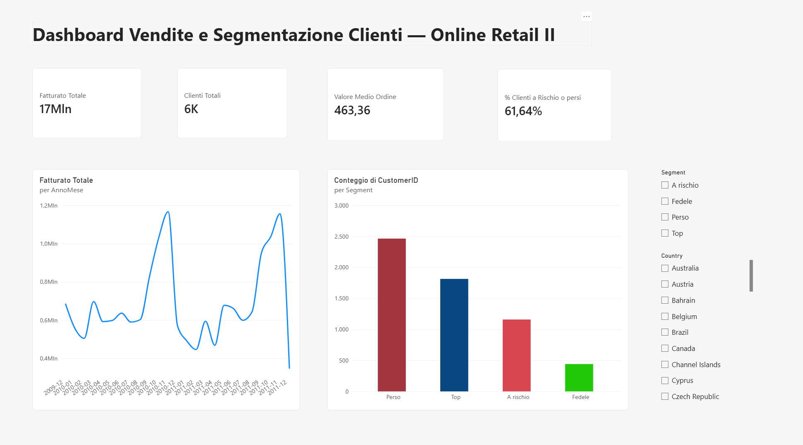
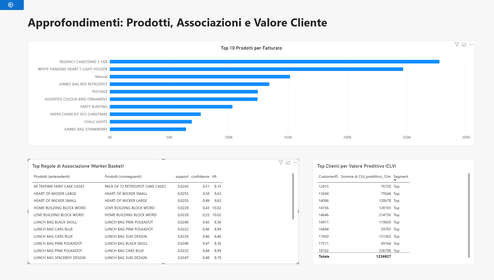
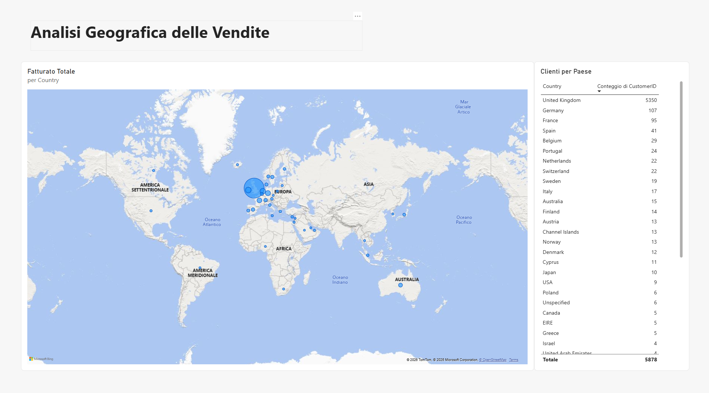
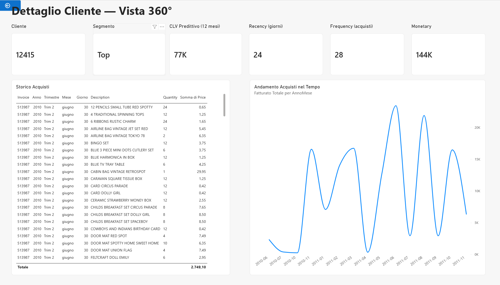

# 📊 Dashboard Vendite e Segmentazione Clienti — Online Retail II

*Un'analisi end-to-end che unisce SQL, statistica, machine learning predittivo e business intelligence per trasformare oltre 779.000 transazioni grezze in decisioni di business concrete.*

---

## 📌 Obiettivo

Un e-commerce britannico ha due anni di storico vendite (2009-2011) e tre domande di business molto concrete:

1. **Quali clienti rischiano di abbandonarci, e quanto valgono nel tempo?**
2. **Cosa comprano insieme i nostri clienti, e come possiamo sfruttarlo per il cross-selling?**
3. **Dove concentrare gli sforzi commerciali, geograficamente e per segmento?**

Questo progetto risponde a tutte e tre partendo dallo stesso dataset, con un'unica analisi organica invece di tre esercizi scollegati — esattamente come farebbe un vero incarico di consulenza.

## 🗂️ Dati

- **Fonte**: [Online Retail II](https://archive.ics.uci.edu/dataset/502/online+retail+ii) — UCI Machine Learning Repository
- **Dimensione**: 779.423 transazioni pulite, 5.878 clienti distinti, 40 paesi
- **Periodo**: dicembre 2009 – dicembre 2011
- **Contenuto**: fatture, prodotti, quantità, prezzi, clienti e paese di un e-commerce di articoli da regalo con base nel Regno Unito
- **Valuta**: tutti gli importi sono in sterline (£)

**Download**: il dataset non è incluso nel repository. Scarica `online_retail_II.xlsx` dalla [pagina UCI del dataset](https://archive.ics.uci.edu/dataset/502/online+retail+ii) (se ottieni un archivio `.zip`, estrai il file) e salvalo in:

```
data/raw/online_retail_II.xlsx
```

**Attribuzione**: Chen, D. (2012). Online Retail II [Dataset]. UCI Machine Learning Repository. https://doi.org/10.24432/C5CG6D — distribuito con licenza [CC BY 4.0](https://creativecommons.org/licenses/by/4.0/).

## 🛠️ Stack Tecnologico

| Strumento | Ruolo in questo progetto |
|---|---|
| **SQL Server** | Database in cui vengono caricate le transazioni pulite (creazione del database e della tabella, caricamento) |
| **Python** (pandas, scipy, mlxtend, lifetimes) | Pulizia, segmentazione RFM, statistica inferenziale, Market Basket Analysis, CLV predittivo |
| **Excel / Google Sheets** | Pivot table, analisi what-if di retention |
| **Power BI** | Dashboard interattiva a 4 pagine con drill-through |

## 🔍 Metodologia

Il progetto si sviluppa in 7 fasi, ciascuna con un obiettivo preciso:

### 1. Pulizia dati ed Exploratory Data Analysis (Python)
Caricamento del dataset grezzo, unione dei due fogli annuali, gestione di valori mancanti, quantità/prezzi anomali e codici fattura di cancellazione. **Decisione metodologica chiave**: due transazioni singole con quantità implausibili (80.995 e 74.215 unità di articoli da regalo, riconducibili a errori di inserimento) sono state escluse in modo mirato e documentato — a differenza di clienti con acquisti ricorrenti all'ingrosso legittimi, che sono stati mantenuti (vedi sezione "Sfide tecniche" per i dettagli).

### 2. Caricamento su SQL Server e Segmentazione RFM (Python)
I dati puliti vengono caricati in un database SQL Server locale con lo script `sql/load_to_sqlserver.py`, che crea il database e la tabella `dbo.transactions` se non esistono e vi importa il CSV pulito.

La segmentazione RFM è calcolata nel notebook `02_rfm_segmentation` con pandas. Per ogni cliente si calcolano **Recency** (giorni dall'ultimo acquisto), **Frequency** (numero di fatture distinte) e **Monetary** (spesa totale); ogni metrica viene convertita in un punteggio da 1 a 4 per quartili e una regola a priorità assegna il cliente a uno di quattro segmenti: **Top, Fedele, A rischio, Perso**.

### 3. Analisi statistica dell'abbandono (Python)
Confronto statistico tra i segmenti a rischio e quelli fedeli, con test d'ipotesi sulle differenze di comportamento d'acquisto e analisi di correlazione tra le tre metriche RFM.

### 4. Market Basket Analysis (Python — algoritmo Apriori)
Quali prodotti vengono acquistati insieme? Costruita la matrice fattura-prodotto sul mercato UK e applicato l'algoritmo Apriori per estrarre regole di associazione, filtrate per **lift > 1** (associazione reale, non casuale) e ordinate per forza della relazione.

### 5. Customer Lifetime Value predittivo (Python — modello BG/NBD + Gamma-Gamma)
Oltre al CLV storico (quanto ha speso finora un cliente), è stato stimato il **CLV predittivo a 12 mesi**: quanto varrà probabilmente ogni cliente in futuro, usando il modello Beta-Geometric/Negative Binomial Distribution combinato con Gamma-Gamma — lo standard per business non contrattuali come l'e-commerce.

### 6. Analisi Excel — Stagionalità e simulazione What-If
Pivot table sull'andamento mensile del fatturato e simulazione what-if: *"quale impatto avrebbe sui ricavi recuperare una percentuale dei clienti a rischio abbandono?"* — costruita manualmente per dimostrare competenza pratica sullo strumento, non generata via codice.

> **Nota sulla segmentazione RFM**: la simulazione what-if (e il file `excel/customer_rfm.csv`) usa una prima versione della segmentazione RFM, mentre il notebook `02_rfm_segmentation` e la dashboard Power BI usano la versione finale. Per questo i conteggi dei segmenti sono diversi: ad esempio i clienti "A rischio" sono 1.857 nell'analisi Excel e 1.159 nella dashboard.

### 7. Dashboard Power BI — 4 pagine interattive
- **Panoramica**: KPI principali, andamento mensile del fatturato, distribuzione clienti per segmento, con slicer per paese e segmento
- **Approfondimenti**: top 10 prodotti per fatturato, top regole di Market Basket, top clienti per CLV predittivo
- **Geografia**: mappa e classifica del fatturato per paese
- **Dettaglio Cliente**: pagina con **drill-through** — cliccando su un cliente da qualsiasi tabella, si apre una vista a 360° con il suo profilo RFM, CLV predittivo e storico acquisti completo

## 🖥️ Dashboard

**Panoramica**



**Approfondimenti**



**Geografia**



**Dettaglio Cliente**



## 🐛 Sfide tecniche e come le ho risolte

Un'analisi non è solo eseguire tecniche corrette: è anche saper riconoscere quando qualcosa non torna. Ecco i problemi più significativi incontrati e come li ho diagnosticati.

**Il bug del separatore decimale (ricorrente, 4 volte)**
Durante l'importazione in Power BI, alcune colonne numeriche (Price, Monetary, CLV predittivo) venivano interpretate secondo le impostazioni locali italiane (virgola come decimale) invece che con il formato originale del file (punto come decimale). Risultato: valori gonfiati di un fattore ~100-1000x — un fatturato totale che doveva aggirarsi sui 17 milioni di sterline veniva mostrato come "2 miliardi". Ho isolato il problema creando misure di verifica indipendenti (`SUM(Quantity)` e `SUM(Price)` separatamente) per capire quale colonna fosse la fonte dell'errore, poi corretto forzando il tipo di dato con l'impostazione locale esplicita "Inglese (Stati Uniti)" in Power Query. Il problema si è ripresentato in modo identico su tre colonne diverse in momenti diversi, e una quarta volta nella tabella del Market Basket in Power BI: support, confidence e lift venivano letti come numeri interi con le impostazioni locali italiane, così il lift risultava fino a oltre 140.000 invece del valore reale massimo di 14,09. Anche in questo caso l'ho risolto impostando nella query le impostazioni locali "Inglese (Stati Uniti)" — un buon promemoria che un fix va sempre verificato su tutte le tabelle collegate, non solo su quella dove è stato notato per la prima volta.

**Outlier nei dati: distinguere un errore da un cliente legittimo**
Ordinando la colonna Quantity in ordine decrescente, sono emerse transazioni con quantità superiori a 80.000 unità. Anziché applicare un taglio generico per soglia (che avrebbe eliminato anche clienti all'ingrosso legittimi), ho analizzato la concentrazione: due transazioni erano isolate, singole, su articoli da regalo — pattern tipico di un errore di inserimento. Un altro cliente aveva invece acquisti ricorrenti e coerenti nel tempo su prodotti da rivendita a basso costo unitario — pattern tipico di un rivenditore B2B. Solo le due transazioni anomale sono state escluse, con la logica documentata direttamente nel codice.

**La colonna "AnnoMese" che continuava a tornare data**
Per raggruppare il grafico mensile del fatturato, ho creato una colonna calcolata con `FORMAT(InvoiceDate, "YYYY-MM")`. Power BI la riconvertiva però automaticamente in un tipo Data, riapplicando la sua gerarchia automatica e mostrando timestamp dettagliati invece di mesi puliti. Risolto eliminando e ricreando la colonna forzando esplicitamente il tipo "Testo", dopo aver verificato con un controllo sul numero di valori distinti (da oltre 34.000 attesi a circa 25) che la colonna funzionasse davvero come raggruppamento mensile.

## 📊 Risultati principali

- **Fatturato totale analizzato**: circa £17,1 milioni su 779.423 transazioni
- **Base clienti**: 5.878 clienti in 40 paesi, con una concentrazione fortissima nel **Regno Unito** (oltre il 91% dei clienti) — segno di un business ancora poco internazionalizzato nonostante una coda lunga di mercati europei minori (Germania, Francia, Spagna in testa)
- **Segmentazione** (versione finale, notebook 02 e dashboard): il segmento "Perso" risulta il più numeroso (2.464 clienti), seguito da "Top" (1.814), "A rischio" (1.159) e "Fedele" (441). "Perso" e "A rischio" insieme rappresentano circa il 62% della base clienti — un campanello d'allarme sulla fedeltà nel medio periodo — mentre i clienti "Top" hanno una spesa media di circa £7.250, contro circa £340 dei clienti persi
- **Market Basket**: emergono associazioni di prodotto molto forti (lift massimo 14,09: la coppia di prodotti viene acquistata insieme oltre 14 volte più spesso di quanto accadrebbe per puro caso) tra articoli complementari dello stesso tema decorativo (es. set "Heart of Wicker" piccolo e grande, lift 9,63) — opportunità dirette di cross-selling e bundle
- **CLV predittivo**: il cliente a maggior valore predetto a 12 mesi supera i £230.000, un profilo chiaramente B2B che merita un trattamento commerciale dedicato rispetto al cliente retail medio

## 💡 Conclusioni e raccomandazioni

1. **Investire in retention mirata sul segmento "A rischio"**: la simulazione what-if mostra un incremento di fatturato stimato significativo anche recuperando solo il 10% di questi clienti — un ROI potenzialmente favorevole rispetto al costo di acquisizione di nuovi clienti
2. **Sfruttare le regole di Market Basket per il cross-selling**: posizionare prodotti fortemente associati vicini nel catalogo online o proporli come bundle in fase di checkout
3. **Trattare diversamente i clienti ad alto CLV predittivo**: in particolare i profili B2B/all'ingrosso meritano un account dedicato, non lo stesso funnel del cliente retail occasionale
4. **Valutare un'espansione internazionale mirata**: la concentrazione UK è un rischio di dipendenza da un singolo mercato; Germania e Francia, già secondi mercati per fatturato, sono i candidati naturali per un primo investimento di marketing mirato

## ⚠️ Limiti e sviluppi futuri

- Il modello CLV predittivo assume comportamenti d'acquisto stazionari nel tempo; andrebbe ricalibrato periodicamente con dati più recenti
- L'analisi geografica si ferma al fatturato aggregato per paese; un'estensione naturale sarebbe l'analisi di marginalità per mercato, non disponibile in questo dataset
- Il Market Basket Analysis è limitato al mercato UK per contenere la complessità computazionale; estenderlo ad altri mercati potrebbe rivelare pattern regionali diversi

## 🚀 Come riprodurre il progetto

### Requisiti
- **Python 3.14** (il progetto è stato sviluppato ed eseguito con Python 3.14.6)
- **Power BI Desktop**, per aprire la dashboard
- **SQL Server** con driver ODBC, solo per il passaggio facoltativo di caricamento su database

### 1. Clona il repository e installa le dipendenze

```bash
git clone https://github.com/luigipomata/retail-customer-analysis.git
cd retail-customer-analysis
pip install -r requirements.txt
```

### 2. Scarica i dati
Salva il dataset in `data/raw/online_retail_II.xlsx` come descritto nella sezione **Dati**.

### 3. Esegui i notebook
Esegui i notebook in ordine, da `01_eda` a `05_clv`. I percorsi nei notebook sono relativi alla cartella di ciascun notebook (`../../data/...`), quindi vanno aperti dalla loro cartella (comportamento predefinito di Jupyter e VS Code).

| Notebook | Legge | Produce in `data/processed/` |
|---|---|---|
| `01_eda` | `data/raw/online_retail_II.xlsx` | `online_retail_clean.csv` |
| `02_rfm_segmentation` | `online_retail_clean.csv` | `customer_rfm.csv` |
| `03_abbandono_stagionalita` | `customer_rfm.csv` | — |
| `04_market_basket` | `online_retail_clean.csv` | `market_basket_rules.csv` |
| `05_clv` | `online_retail_clean.csv`, `customer_rfm.csv` | `customer_clv_predittivo.csv` |

I notebook non usano SQL Server e non richiedono il file `.env`.

### 4. (Facoltativo) Caricamento su SQL Server
Dopo il notebook `01_eda` puoi caricare le transazioni pulite su SQL Server:

1. copia `.env.example` in `.env` e inserisci i parametri di connessione del tuo SQL Server (il file `.env` serve **solo** a questo script e non va versionato);
2. esegui:

```bash
python sql/load_to_sqlserver.py
```

Lo script crea il database (nome in `SQL_DATABASE`, predefinito `RetailAnalysis`) e la tabella `dbo.transactions` se non esistono, svuota la tabella e la ricarica da `data/processed/online_retail_clean.csv`, così può essere rieseguito senza creare duplicati. Il file `sql/create_transactions_table.sql` contiene la stessa DDL della tabella a solo scopo di documentazione: non viene eseguito dalla pipeline.

### 5. Dashboard Power BI
`dashboard/dashboard_retail.pbix` contiene già i dati importati, quindi si apre e si consulta senza eseguire nulla. Per aggiornarla con i dati rigenerati sul tuo PC, la sorgente dati va ripuntata ai tuoi file: in Power BI Desktop apri **Trasforma dati → Impostazioni origine dati → Cambia origine** e indica il percorso dei quattro CSV in `data/processed/` (`online_retail_clean.csv`, `customer_rfm.csv`, `market_basket_rules.csv`, `customer_clv_predittivo.csv`), poi **Aggiorna**.

## 📁 Struttura del repository

```
├── data/                 # non versionata: da creare in locale (vedi "Dati")
│   ├── raw/              # dataset originale
│   └── processed/        # dati puliti e output delle analisi
├── docs/
│   └── img/              # screenshot della dashboard
├── sql/                  # caricamento su SQL Server e DDL di riferimento
├── notebooks/
│   ├── 01_eda/
│   ├── 02_rfm_segmentation/
│   ├── 03_abbandono_stagionalita/
│   ├── 04_market_basket/
│   └── 05_clv/
├── excel/                # pivot table e simulazione what-if
├── dashboard/            # report Power BI (.pbix)
├── LICENSE
└── README.md
```

## 📄 Licenza

Il codice di questo repository è distribuito con licenza **MIT** (vedi [LICENSE](LICENSE)).

I dati restano sotto la licenza del dataset originale, **CC BY 4.0**: questo vale per il dataset Online Retail II e per i dati da esso derivati inclusi nel repository (file in `excel/` e dati importati nella dashboard Power BI). Vedi la sezione **Dati** per l'attribuzione.
